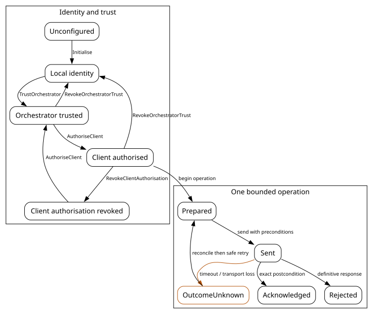

# Client lifecycle

The Client process is normally short-lived, so the useful lifecycle is the
identity and bounded-operation lifecycle rather than process uptime. See the
[Graphviz source](diagrams/client-lifecycle.dot).

## Identity transitions

| Action | Required evidence | Result |
|---|---|---|
| Initialise | Writable private configuration path | Client identity exists locally |
| TrustOrchestrator | Exact Orchestrator fingerprint is approved | The Client trusts that controller identity |
| AuthoriseClient | Orchestrator grants the Client role | Remote operations may be evaluated |
| RevokeOrchestratorTrust | Client removes the trusted Orchestrator identity | The Client refuses new connections to that controller |
| RevokeClientAuthorisation | Orchestrator removes the Client role | New authenticated operations are rejected |

## Operation transitions

An operation moves `Prepared -> Sent -> Acknowledged` only when its exact
postcondition is observed. Timeout or transport loss enters `OutcomeUnknown`;
a status/read reconciliation determines whether retry is safe. A retry reuses
generation and identity preconditions rather than silently issuing a new
unconditional mutation. A definitive authenticated response may instead enter
`Rejected`, carrying a reason without implying a side effect.

## Initial invariants to formalise

- An untrusted Orchestrator never receives Client credentials or Workspace data.
- `Adopted => ExactManifestMaterialised`.
- `OutcomeUnknown` is never presented as failed-with-no-side-effect.
- Local source is not replaced without explicit pull/recovery intent.
- Retry cannot weaken an original generation precondition.

## Implementation map

- Identity setup: [`internal/cli/auth.go`](../../internal/cli/auth.go)
- Orchestrator trust persistence: [`internal/identity`](../../internal/identity/)
- Workspace operations: [`internal/daftclient`](../../internal/daftclient/)
- Local compensation tests: [`internal/cli`](../../internal/cli/)

Parent: [Client](client.md). Related: [Workspace lifecycle](workspace-lifecycle.md).
