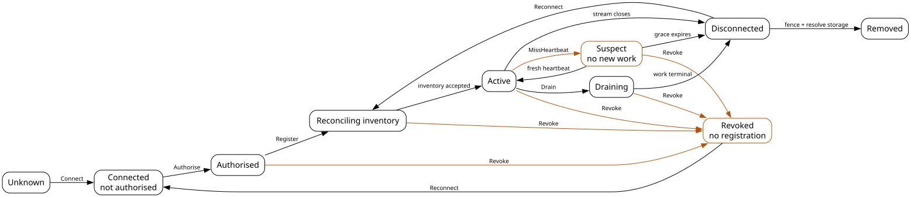

# Node lifecycle

Node lifecycle composes transport connection, authorisation, heartbeat
freshness, admission, and inventory reconciliation. `Suspect` and `Draining`
are architectural states, not current wire enums. See the
[Graphviz source](diagrams/node-lifecycle.dot).

## Abstract transitions

| Action | Required evidence | Result |
|---|---|---|
| Connect | Mutual TLS succeeds | Fingerprint is known; work remains forbidden |
| Authorise | Operator approves the exact fingerprint | Node may proceed to registration |
| Register | Protocol, resources, and required capabilities validate | Control subscription exists |
| ReconcileInventory | Bounded live Sandbox/disk inventory matches accepted state | Node becomes active for admission |
| MissHeartbeat | Last-seen exceeds warning threshold | Node becomes suspect; new work is refused |
| Disconnect | Stream closes or grace expires | Bindings become unknown/unreachable |
| Revoke | Operator removes the exact fingerprint | Registration is closed and new work is forbidden |
| Reconnect | Same identity registers again | Inventory reconciliation precedes admission |
| Drain | Maintenance intent is recorded | New Sandboxes are refused while existing work terminates |
| Remove | Node is disconnected, fenced, and retained state is resolved | Registration may be forgotten |

## Initial invariants to formalise

- `Active => Connected /\ Authorised /\ Fresh /\ InventoryReconciled`
- A connected but unauthorised Node receives no Sandbox specification.
- `Suspect` and `Disconnected` Nodes receive no new Sandbox.
- `Revoked` Nodes cannot retain an admitted registration stream.
- Reconnect cannot bind an old Sandbox UID to a newer Workspace generation.
- Removal cannot make protected Node-local data silently disposable.

## Implementation map

- Registration stream: [`internal/nodectrl`](../../internal/nodectrl/)
- Node-side client: [`internal/nodectrlclient`](../../internal/nodectrlclient/)
- Operator authorisation: [`internal/orchestrator/operator.go`](../../internal/orchestrator/operator.go)
- Heartbeat reconciliation: [`internal/reconciler`](../../internal/reconciler/)

Parent: [Node](node.md). Related: [Sandbox lifecycle](sandbox-lifecycle.md).
