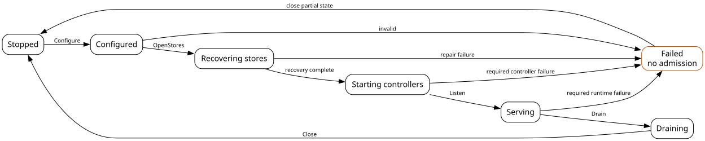

# Orchestrator lifecycle

This lifecycle describes process readiness and durable authority. `Recovering`,
`Draining`, and `Failed` are architectural states, not current public enums.
See the [Graphviz source](diagrams/orchestrator-lifecycle.dot).

## Abstract transitions

| Action | Required evidence | Result |
|---|---|---|
| Configure | Required files, addresses, and policy validate | Startup inputs are immutable |
| OpenStores | Durable stores open and migrations/repairs finish | Authority can be reconstructed |
| StartControllers | Reconciler and bounded background workers report ready | Observations can be processed |
| Listen | Control listener is bound with authentication | Operation admission may begin |
| Drain | Shutdown intent is received | New mutating operations are refused |
| Close | Sessions finish or hit deadlines; stores flush and close | Process stops |
| Fail | A required component cannot start or continue safely | Admission stops with diagnostics |

## Initial invariants to formalise

- `Serving => StoresRecovered /\ ControllersReady /\ AuthenticatedListener`
- A partially opened store never permits mutation.
- Replayed Node observations cannot replace a newer binding.
- Every accepted bridge session is closed or times out during draining.
- Restart preserves monotonic Workspace generations and terminal observations.

## Implementation map

- Startup/teardown: [`internal/orchestratorcli/cli.go`](../../internal/orchestratorcli/cli.go)
- Controller assembly: [`internal/orchestrator`](../../internal/orchestrator/)
- Persistent stores: [`internal/workspacecatalog`](../../internal/workspacecatalog/)
- Process tests: [`internal/orchestratorcli`](../../internal/orchestratorcli/)

Parent: [Orchestrator](orchestrator.md). Related: [Cluster lifecycle](cluster-lifecycle.md).
