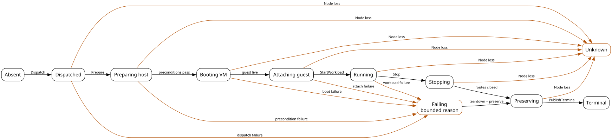

# Sandbox lifecycle

The public wire phase is currently a forward-compatible string with Running,
Exited, and Killed observations. The finer states below expose protocol
boundaries that are presently open-coded. See the
[Graphviz source](diagrams/sandbox-lifecycle.dot).

## Abstract transitions

| Action | Required evidence | Result |
|---|---|---|
| Dispatch | Node, Workspace generation, resources, and image are fixed | Sandbox UID is immutable |
| Prepare | Host files, devices, cgroups, disk, network, and VMM validate | VM may be created |
| Boot | VMM starts and guest liveness is established | Guest control may be negotiated |
| AttachGuest | Expected guest protocol responds | Container may be created |
| StartWorkload | Container and routes start successfully | Running may be reported |
| Stop | Exact Sandbox receives teardown request | New sessions are refused |
| Fail | A required preparation, boot, attach, or workload invariant fails | Failure teardown begins with a bounded reason |
| Preserve | Writable state is verified and published | Terminal phase may be committed |
| PublishTerminal | Routes are closed and preservation outcome is durable | Binding may be cleared |
| Lose | Node evidence disappears before terminal publication | State becomes unknown |

## Initial invariants to formalise

- `Running => GuestAttached /\ WorkloadStarted /\ LimitsApplied`.
- Only the bound Node may publish observations for a Sandbox UID.
- Terminal publication happens at most once per UID and never clears a newer UID.
- `Terminal => RoutesClosed /\ PreservationOutcomeRecorded`.
- Every admitted failure reaches terminal publication or an explicit lost state.
- Loss never implies clean preservation or successful deletion.

## Implementation map

- Host preparation: [`internal/sandboxboot`](../../internal/sandboxboot/)
- Guest/container execution: [`internal/sandboxexec`](../../internal/sandboxexec/)
- Route/session teardown: [`internal/sandboxgateway`](../../internal/sandboxgateway/)
- Terminal ordering tests: [`internal/sandboxexec/exec_test.go`](../../internal/sandboxexec/exec_test.go)

Parent: [Sandbox](sandbox.md). Related: [Workspace lifecycle](workspace-lifecycle.md).
