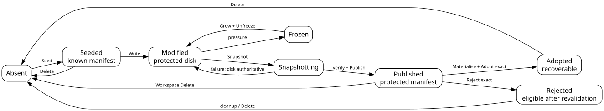

# Workspace storage lifecycle

Storage lifecycle is per manifest generation and retained disk. The
[Graphviz source](diagrams/storage-lifecycle.dot) is a projection; cleanup
eligibility remains an independently checked property.

## Abstract transitions

| Action | Required evidence | Result |
|---|---|---|
| Seed | Client manifest chunks verify | Disk begins from a known generation |
| Write | Running Sandbox mutates XFS | Disk becomes protected authority |
| Snapshot | Files are streamed and every chunk verifies | Immutable manifest is staged |
| Publish | Manifest body and generation pointer commit | Protected snapshot is durable |
| Materialise | Client reconstructs exact manifest successfully | Acknowledgement may be sent |
| Adopt | Digest and generation match current protected snapshot | Data becomes recoverable |
| Reject | Exact protected generation and Client baseline are known | Sandbox snapshot becomes eligible |
| Freeze | Usage or host pressure crosses policy threshold | Further growth is blocked |
| Grow | qcow2 resize and guest `xfs_growfs` both succeed | Explicit unfreeze may proceed |
| Delete | Workspace intent and references revalidate | Disk and eligible manifests are removed |

## Initial invariants to formalise

- `Protected => not CleanupEligible`.
- `Adopted => MaterialisedExactDigest /\ MaterialisedExactGeneration`.
- Snapshot publication never points at unverified chunks.
- Failed snapshot preserves the disk and prior published manifest.
- Disk removal requires no unfenced writer and exact Workspace deletion intent.

## Implementation map

- Transactional manifests: [`internal/casindex`](../../internal/casindex/)
- Snapshot worker: [`internal/workspacesnapshot`](../../internal/workspacesnapshot/)
- Cleanup policy: [`internal/casindex/policy.go`](../../internal/casindex/policy.go)
- Disk resize/control: [`internal/workspacedisk`](../../internal/workspacedisk/)

Parent: [Storage](storage.md). Related: [Workspace lifecycle](workspace-lifecycle.md).
